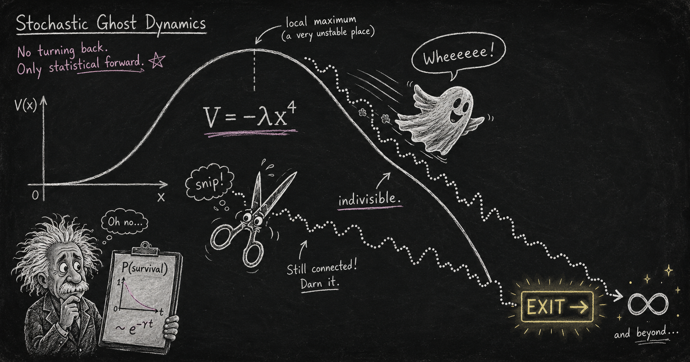

# Indivisible stochastic processes for non-Hermitian and higher-derivative quantum systems

*detailed balance, broken PT symmetry, and the explosion of ghosts*



<sub>*Banner image: prompt written by Claude (Anthropic), rendered by ChatGPT (OpenAI).*</sub>

**Paper 1 of the [Indivisible Ghosts program](https://github.com/embeddetech/ghosts-program).** Jonathan Torkelson (2026).

**[Read the paper (PDF)](indivisible-ghosts-paper.pdf)** · LaTeX source in [`paper/`](paper/)

> **Status: working draft.** This manuscript is under the program's release-gate audit and is still being revised. It has not been peer reviewed. Read it accordingly; corrections land here as they are made.

## Abstract

Barandes’ stochastic–quantum correspondence represents unitary quantum theory by *indivisible* stochastic processes on a configuration space, while the antilinearity program of Bender and Mannheim replaces Hermiticity by $`\mathcal{PT}`$ symmetry, recovering unitarity in a modified inner product. We ask whether these two reconstructions are compatible, and follow the question from the canonical $`2\times 2`$ $`\mathcal{PT}`$ dimer to interacting Pais–Uhlenbeck-type ghosts. Our results: (i) unbroken antilinear symmetry is exactly the condition for a probability-conserving process to exist *without enlarging the configuration space* (via a time-independent beable map)—on beables generically rotated from the original configurations—and the metric-corrected process is the ordinary (generically indivisible) process of the isospectral Hermitian partner; (ii) a non-Hermitian Hamiltonian admits a *fixed-beable* representation iff its on-site energies are real and its couplings are two-way with positive pair products obeying a Kolmogorov cycle (detailed-balance) condition, and the resulting process is unique—in gauge language, fixed beables exist precisely when the imaginary gauge flux vanishes—the exact obstruction, of which the non-Hermitian skin effect is the spectral manifestation; (iii) the broken phase, treated as an open subsystem by dilation, supports a valid sub-stochastic process whose indivisibility is *terminal* rather than recurrent—we prove exact closed forms, including the generator floor $`-(\sin\theta+\tilde\kappa)`$ (a floor on the indivisibility strength $`|L_{12}|`$, approached from below by the signed entry)—while late-time information backflow vanishes numerically: the two notions of non-Markovianity dissociate; (iv) the exceptional point is a coordinate singularity of the Hermitian dictionary, not of the process; (v) the free Pais–Uhlenbeck ghost admits a perfectly valid fixed-beable process on the truncated configuration space, whereas the no-ghost quantization exits the sample space; (vi) interacting ghosts realize the probabilist’s classification conservative/transient/explosive (the last at the mechanism level), and (vii) a deficiency-index/Feller analysis proves an “explosion dictionary” for the one-dimensional monotone mechanism model: one classical integral decides classical completeness, quantum self-adjointness (its limit-circle leg under $`C^{2}`$ error control), and stochastic conservativity, with (viii) a rigorous channel-based multidimensional extension (for separable, central, and boundedly-coupled model classes) in which conservative completions carry an infinite-dimensional, channel-mixing $`S`$-matrix at infinity. For the exact quartic Pais–Uhlenbeck operator we further prove an exact displaced-oscillator identity whose channelization (exact up to $`O(k^{2})`$) carries a sign prediction the numerics confirm ($`\lambda>0`$: limit-circle channels; $`\lambda<0`$: a quantum-completion candidate despite classical blowup), settle deficiency stability at every finite Galerkin channel number, certify the one-dimensional fiber non-self-adjoint, in a computer-assisted sense, by a glued-tail von Neumann certificate—no compactly supported function can witness deficiency—and conjecturally reduce the remaining $`M\to\infty`$ step to Gaussian-beam assembly and error control along numerically characterized escape rays. The ghost problem, viewed in the stochastic currency, is a recurrence-classification problem, and the minimal explosive process is its only canonical resolution.

## Reproducing the results

Each script is standalone Python (NumPy/SciPy) and prints its controls inline. The paper's *Code availability* section maps scripts to results.

```
pip install numpy scipy
python scripts/appD_escape_dictionary.py
```

| Script |
|---|
| [`appD_escape_dictionary.py`](scripts/appD_escape_dictionary.py) |
| [`completion_candidates.py`](scripts/completion_candidates.py) |
| [`deficiency_multiD.py`](scripts/deficiency_multiD.py) |
| [`dilation_bridge.py`](scripts/dilation_bridge.py) |
| [`exceptional_point.py`](scripts/exceptional_point.py) |
| [`explosion_theorem.py`](scripts/explosion_theorem.py) |
| [`fixed_beable_kolmogorov.py`](scripts/fixed_beable_kolmogorov.py) |
| [`gap_closure_channels.py`](scripts/gap_closure_channels.py) |
| [`glued_certificate_1d.py`](scripts/glued_certificate_1d.py) |
| [`interacting_pu.py`](scripts/interacting_pu.py) |
| [`lemma_terminal_indivisibility.py`](scripts/lemma_terminal_indivisibility.py) |
| [`maslov_feasibility.py`](scripts/maslov_feasibility.py) |
| [`pais_uhlenbeck.py`](scripts/pais_uhlenbeck.py) |
| [`pt_barandes.py`](scripts/pt_barandes.py) |
| [`pu_bo_channels.py`](scripts/pu_bo_channels.py) |
| [`pu_deficiency_evidence.py`](scripts/pu_deficiency_evidence.py) |
| [`quartic_pu_leak.py`](scripts/quartic_pu_leak.py) |
| [`skin_effect_beables.py`](scripts/skin_effect_beables.py) |
| [`skin_topology_beables.py`](scripts/skin_topology_beables.py) |
| [`tail_certificate.py`](scripts/tail_certificate.py) |

Archived outputs and run notes cited by the paper:

- [`completion_candidates_run.txt`](scripts/completion_candidates_run.txt)
- [`SS9_NUMERICS.md`](scripts/SS9_NUMERICS.md)

## Audit trail and provenance

This manuscript is an experiment in AI-conducted research: the work was carried out by large language models (Claude, Anthropic), directed and reviewed by the author. The paper's provenance statement says who did what. Nothing here should be taken on trust.

- The audit process: [`AUDIT.md`](AUDIT.md)
- Pass-by-pass audit ledger: [`histories/paper1-gate-history.md`](histories/paper1-gate-history.md)
- Pass-by-pass audit ledger: [`histories/paper1-history.md`](histories/paper1-history.md)
- The full research notebook, the originating conversation, and every companion paper: the [program hub](https://github.com/embeddetech/ghosts-program)

## License

MIT — see [`LICENSE`](LICENSE).
